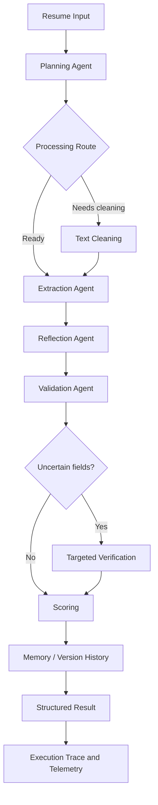

# 🤖 Agentic AI Resume Extractor


An AI-powered resume extraction system that converts unstructured resume content into structured data using a multi-agent workflow. The project explores planning, LLM tool calling, reflection, validation, targeted verification, dynamic routing, scoring, and memory.

> **Research question:** Does agentic orchestration improve resume extraction enough to justify its additional latency and cost?

## 📌 Table of Contents

- [Overview](#-overview)
- [Features](#-key-features)
- [Architecture](#-architecture)
- [Technology Stack](#-technology-stack)
- [Project Structure](#-project-structure)
- [Installation](#-installation)
- [Configuration and Security](#-configuration-and-security)
- [Run the Application](#-run-the-application)
- [Run Tests](#-run-tests)
- [Evaluation Framework](#-evaluation-framework)
- [Preliminary Results](#-preliminary-results)
- [Limitations](#-limitations)
- [Future Improvements](#-future-improvements)

## 🎯 Overview

Traditional resume parsers can struggle with inconsistent formatting, incomplete information, ambiguous dates, and different ways of describing skills and experience.

This project uses a stateful workflow that combines LLM-based reasoning with deterministic utilities and structured validation. It also includes an evaluation framework to compare a non-agentic baseline with the full workflow and controlled ablations.

The aim is to measure whether individual components improve extraction quality, reliability, latency, and cost—not to assume that adding agents automatically makes a system better.

## ✨ Key Features

- **Multi-agent workflow:** planning, extraction, reflection, validation, verification, scoring, and recommendation components.
- **Structured extraction:** produces resume information in a defined schema.
- **Tool calling:** integrates utilities such as email validation, date parsing, skill normalization, and PDF parsing.
- **Reflection and validation:** reviews extracted data and checks output structure.
- **Targeted verification:** supports additional checks for uncertain fields.
- **Memory components:** provides memory and semantic retrieval functionality where configured.
- **Evaluation framework:** compares a baseline, the full agentic workflow, and component ablations.
- **Telemetry and analysis:** supports tracking latency, token usage, estimated cost, and failure rate.
- **Automated tests:** includes a pytest test suite.

## 🏗️ Architecture

The diagram illustrates the intended workflow; actual execution paths depend on runtime decisions and the implementation.



### Agent responsibilities

| Component | Responsibility |
|---|---|
| Planning Agent | Selects an appropriate processing strategy |
| Extraction Agent | Extracts candidate information using the configured LLM and tools |
| Reflection Agent | Reviews extracted information and considers corrections |
| Validation Agent | Checks output structure and data validity |
| Verification Agent | Supports targeted checks of uncertain information |
| Scoring Agent | Scores extracted results |
| Recommendation Agent | Supports recommendation-related functionality |
| Deterministic tools | Handle specific tasks such as parsing, normalization, and validation |

## 🛠️ Technology Stack

| Technology | Purpose |
|---|---|
| Python 3.11 | Core application |
| OpenAI API | LLM-powered processing |
| Pydantic | Structured data validation |
| Pytest | Automated testing |
| Mermaid | Architecture diagrams |
| Docker | Containerization support |
| Embedding-based retrieval | Semantic memory functionality where configured |

## 📂 Project Structure

High-level repository structure:

```text
agentic-ai-resume-extractor/
├── agents/
│   ├── planning_agent.py
│   ├── extraction_agent.py
│   ├── reflection_agent.py
│   ├── validation_agent.py
│   ├── verification_agent.py
│   ├── scoring_agent.py
│   └── recommendation_agent.py
├── tools/
│   ├── date_parser.py
│   ├── email_validator.py
│   ├── pdf_parser.py
│   └── skill_normalizer.py
├── eval/
│   ├── dataset/
│   ├── baseline.py
│   ├── metrics.py
│   ├── telemetry.py
│   ├── run_evaluation.py
│   ├── analyze_results.py
│   ├── reflection_verification_report.py
│   └── README.md
├── tests/
├── utils/
├── app.py
├── agent_graph.py
├── orchestrator.py
├── llm_client.py
├── schema.py
├── security.py
├── memory.py
├── semantic_memory.py
├── knowledge_base.py
├── feedback.py
├── requirements.txt
├── .env.example
├── .gitignore
├── Dockerfile
└── README.md
```

*This is a high-level overview; files and directories may change as the project evolves.*

## 🚀 Installation

### Prerequisites

- Python 3.11
- Git
- An OpenAI API key for workflows that use the OpenAI API

### 1. Clone the repository

```bash
git clone https://github.com/sriramsingamaneni95-glitch/agentic-ai-resume-extractor.git
cd agentic-ai-resume-extractor
```

### 2. Create and activate a virtual environment

**Windows PowerShell:**

```powershell
python -m venv .venv
.\.venv\Scripts\Activate.ps1
```

**macOS/Linux:**

```bash
python3 -m venv .venv
source .venv/bin/activate
```

### 3. Install dependencies

```bash
python -m pip install --upgrade pip
pip install -r requirements.txt
```

## 🔐 Configuration and Security

Create a local `.env` file from the provided example.

**Windows PowerShell:**

```powershell
Copy-Item .env.example .env
```

Edit `.env` and set your own API key:

```text
OPENAI_API_KEY=your_api_key_here
```

Replace the placeholder locally with a valid key. Do not commit the real key.

**Security guidelines:**

- Never commit `.env` or real API keys.
- Keep `.env.example` limited to placeholder values.
- Do not include credentials in README files, screenshots, logs, or public messages.
- Revoke and replace a key immediately if it is exposed.
- Treat resumes as sensitive personal information and protect them appropriately.

## ▶️ Run the Application

From the repository root:

```bash
python app.py
```

The application uses the configuration and dependencies defined by the project. If startup fails, check the Python version, installed dependencies, environment variables, and the error output.

## 🧪 Run Tests

Run the test suite:

```bash
python -m pytest -q
```

The latest locally reported result during development was:

```text
35 passed
```

Test results can change as the code or environment changes, so rerun tests after modifications.

Check for whitespace errors in your current Git changes:

```bash
git diff --check
```

## 📊 Evaluation Framework

The `eval/` package supports comparisons between the non-agentic baseline, the full agentic workflow, and component ablations.

### Dataset

The reported evaluation dataset contains 50 resumes across five categories:

| Category | Cases |
|---|---:|
| Clean | 10 |
| Messy | 10 |
| Multi-column stress cases | 10 |
| Incomplete | 10 |
| Ambiguous | 10 |
| **Total** | **50** |

Text-layout stress cases should not automatically be described as actual multi-column PDF tests unless the corresponding rendered PDF files are included and referenced in the evaluation manifest.

### Variants

| Variant | Reflection | Memory | Verification | Dynamic routing |
|---|---|---|---|---|
| Baseline | No | No | No | No |
| Full agentic workflow | Yes | Yes | Yes | Yes |
| No reflection | No | Yes | Yes | Yes |
| No memory | Yes | No | Yes | Yes |
| No verification | Yes | Yes | No | Yes |
| No dynamic routing | Yes | Yes | Yes | No |

### Metrics

The framework is designed to report:

- Field-level and overall extraction accuracy
- Exact-record match rate
- Failure rate
- Average latency
- Estimated API cost
- LLM calls and token usage
- Reflection and verification corrections
- Memory retrieval and influence evidence
- Execution traces and failure categories

### Run evaluation

From the repository root:

```bash
python -m eval.run_evaluation
```

See `eval/README.md` for additional commands and details. Live benchmarking may require API credentials and can incur API costs.

## 📈 Preliminary Results

The following figures were reported during development and should be treated as **preliminary results from the current evaluation run**, not final scientific conclusions.

| Metric | Baseline | Full agentic workflow |
|---|---:|---:|
| Reported extraction accuracy | 72.74% | 92.73% |
| Reported failure rate | 32% | 0% |
| Average latency | 1.98 seconds | 11.10 seconds |
| Estimated average cost per run | $0.0015 | $0.0082 |

In this run, the full workflow had higher reported extraction accuracy and a lower failure rate than the baseline, but also higher latency and estimated cost.

**Interpretation notes:**

- Results depend on the dataset, model configuration, and evaluation implementation.
- Some ablation variants exhibited implementation errors during the reported evaluation.
- Ablation results should not be treated as reliable evidence of component impact until those errors are fixed and the evaluation is rerun.
- Verify metric definitions against the evaluation code before publishing these figures externally.
- Cost estimates depend on model pricing and recorded usage.

## ⚠️ Limitations

- LLM outputs can be incorrect or incomplete.
- Synthetic datasets may not represent the diversity of real-world resumes.
- Ground-truth labels may require independent review before being treated as verified.
- Reflection and verification can increase latency and API cost.
- Memory retrieval does not by itself demonstrate a benefit to the final result.
- Ablation studies require valid implementations and repeatable evaluation conditions.
- Preliminary metrics should be rerun after implementation fixes.

This project is an extraction aid, not a substitute for human review in high-impact hiring decisions.

## 🔮 Future Improvements

- Fix and rerun ablation experiments.
- Expand unit and integration test coverage.
- Improve field-level error analysis.
- Validate extraction on actual PDF layout variations.
- Add independently reviewed ground-truth labels.
- Improve evaluation reproducibility and reporting.
- Measure the impact of memory and reflection.
- Optimize latency and API costs.
- Add continuous integration and strengthen privacy/security controls.

## 🤝 Contributing

Suggestions and improvements are welcome. Contributions should include relevant tests where appropriate, preserve the structured extraction contract, document evaluation changes, and never introduce credentials or sensitive resume data.

## 📄 License

No license is specified in this README. Add a `LICENSE` file before explicitly granting permissions for reuse, modification, or distribution.

## 👨‍💻 Author

**Sriram Singamaneni**

GitHub: [sriramsingamaneni95-glitch](https://github.com/sriramsingamaneni95-glitch)

**Project:** Agentic AI Resume Extractor

---

> The goal is not simply to add more agents to a resume parser. It is to measure whether planning, tool use, reflection, verification, routing, and memory improve extraction enough to justify their additional complexity.
